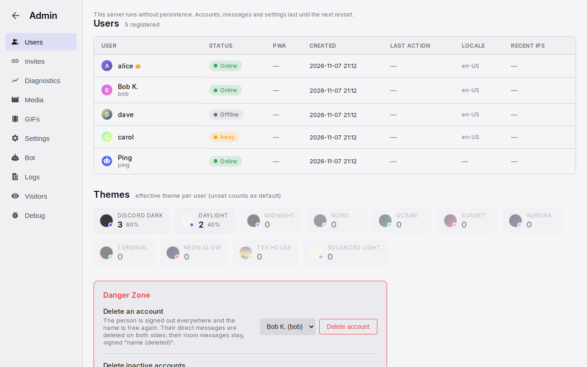

# Administration

Administration is the admin's page for the server. It covers the people, the invites and login links, the registration switches and the bot. It also covers the server switches, the server's GIF library, the logs and the live diagnostics. There is one admin, the first human account on the server. Rooms are created and changed on separate pages that open from the sidebar. This page also specifies those room pages.

## Anatomy

1. **Navigation.** A 180 px column with a round back arrow, "Admin", and the tabs Users, Invites, Diagnostics, Media, GIFs, Settings, Bot, Logs, Visitors, Debug. On a phone, the tabs are a horizontal tab bar under the back arrow.
2. **Content.** The open tab, with a title row (name and a count or subtitle), stat cards where the tab has them, filters, and tables that scroll sideways when wide. Forms and settings boxes share one column, at most 640 px wide.
3. **Tables.** Headers in small capitals. A table adds 24 rows for each "Show more" tap, or 100 rows for each "Load more" page. On a phone, a wide table scrolls sideways and no column is hidden.
4. **Room pages.** "Create Channel" and "Channel Settings", inside the chat frame, with the cards Channel Info, Permissions, Pinned Messages, History Visibility, Channel Order and Danger Zone.

## Rules

### Access and layout

**AD-01** Only the admin can open the page, from "Admin" in the status menu. Any other person goes to the lobby. The page is outside the chat frame and uses the theme's colours. The back arrow goes to the lobby. The back arrow is also present on phones.

**AD-02** Users opens first. A link to a tab, such as the one in the GIF picker, opens that tab. Users, Bot, Invites and Settings load with the page. Logs, Media and Visitors load when they open for the first time. GIFs loads again each time it opens. Diagnostics refreshes every 30 seconds while it is open.

**AD-03** Persistence is the optional saved copy of accounts, messages and settings. When the server runs without persistence, the top of the page shows "This server runs without persistence. Accounts, messages and settings last until the next restart." Logs, Media and Visitors then show "Not available without persistence." instead of an empty tab. With persistence, the server can start with only the newest messages of each conversation: a count and a number of days, both set in the server's configuration file. The admin page does not show them. Older messages stay in the saved copy. No one can read them, the admin included, until the limit changes and the server starts again.

### Users

**AD-04** The Users table lists every account, including the bot, with the newest activity first. Each row shows the avatar, the display name with the admin crown, the username and a status pill. The pill is Online, Away, Invisible or Offline, and the admin sees Invisible as Invisible. The row also shows whether the installed app was seen, the creation time and the last action. It also shows the time zone and language, and up to five recent network addresses. The table is read when the page loads and does not change until the next load.

**AD-05** A tap on a row opens its detail. The detail shows the notification devices, the installed app and the effective theme. It also has a table of addresses with countries and a table of browsers. Both tables show the last seen time.

**AD-06** The page has no disable, rename, admin transfer or forced sign-out for an account. The only rescue is a new login link from the Invites tab. Deletion is in the Danger Zone at the bottom of the tab (AD-38 to AD-40).

**AD-07** Under the table, Themes shows one card for each theme, with its count and share. The cards are in order of use, most used first. Unused themes are dimmed.

**AD-38** Under Themes, Danger Zone has a red frame. "Delete an account" offers every account except the admin and the bot in a list, with "Delete account". The tap opens a red dialog, "Delete {username}?", with the name and what goes: the person is signed out everywhere, their direct messages are deleted on both sides, their room messages stay signed "{username} (deleted)", the name is free again, and this cannot be undone. "Delete account" in the dialog deletes. "Cancel", Escape or a tap outside keeps the account. After the delete, the line "Deleted {username}." shows and the table loads again.

**AD-39** "Delete inactive accounts" takes a number of days, 90 by default. "Find" lists the accounts whose last visit is older than that, oldest first, each with the time since. A visit is the start or the end of a connection; an account that never connected counts from its creation. A connected person is never listed. The admin and the bot are never listed. With nobody found, the line says "Every account was active in the last {n} days." ("day" for one). With no account to offer, the account list says "No accounts", and the list and "Delete account" are disabled. "Find" stays enabled, so the admin can search again with another number of days. Otherwise "Delete {n} accounts" opens the same red dialog with the names. The accounts in the list go, and the line "Deleted {n} accounts." shows.

**AD-40** A deleted account is signed out on every device at once. Its saved sign-in, its passphrase, its login link and its installed app no longer sign in. Its notification devices, mute choices, GIF favorites, profile picture and unused GIF uploads go. Its direct messages are deleted on both sides, the bot's welcome included. Its room messages and reactions stay, signed "{username} (deleted)" with the default picture, and replies to them keep their quotes. Its pins in rooms stay too. A pinned entry shows "{username} (deleted)" as the author and in "Pinned by". The account leaves the selected pinners of every room. The username is free again, and a newcomer who takes it inherits nothing. Open chats drop the person from the people list and the direct message from the sidebar at once; a chat open on that direct message goes to the lobby. The logs keep their rows. The admin and the bot cannot be deleted. *Why:* without an admin the next sign-up would become the admin, and the bot would come back at the next start without its conversations.

### Debug

**AD-08** The message generator posts test messages into a chosen room. The admin chooses a count (default 200) and a span from an hour to a year. The generator spreads the messages over the span, in bursts. They are real messages from the admin and five fictional people. Generated messages add no unread counts.

### Bot

**AD-09** Bot Settings shows the bot's picture, its fixed username, its display name and the three parts of the welcome message: the welcome, the phone part and the login link part. "Upload picture" sets a new picture by the rules of a person's own picture; "Use the default" brings the robot back. The display name and the picture survive a restart. In the parts, "{server}" (or the older "{0}") stands for the server name, "{link}" for the person's login link and "{code}" for its code. "[pwa-install]" becomes the install link. A preview shows the message as a phone user with a link receives it. "Save" confirms with "Saved!". The bot sends the welcome message one minute after a person's first session: the welcome, then the phone part on a phone, then the login link part when the person has a link. An empty part is left out. Below the preview, "Return notice (hours)" is the absence after which the bot tells the admin that a person is back (PR-18): a whole number from 0 to 720, 0 turns the notice off.

### Settings tab

**AD-10** Registration has three switches: "Close registration", "Require approval" and "Smart login". Each switch saves at once. Smart login is on by default. Their effects are on the [sign-in page](sessions.md#AU-05).

**AD-11** Pending Requests shows while someone waits for approval. Each request shows the username, how long ago it arrived, "Approve" and "Reject". The list updates automatically when a request arrives. For each request, the admin also gets a message from the bot. Pending requests are lost when the server restarts.

**AD-12** Link Previews has "Enable link previews" (on by default) and "Enable media caching" (off by default). When the downloader is missing, "Enable media caching" is disabled and shows a note. Both switches apply at once to every open chat.

**AD-13** GIFs has the content rating of the provider: G, PG, PG-13 or R. The default is PG. A change applies to the next search. Under the rating, a row in the colour of the state shows "Provider: configured" in green or "Provider: not configured" in red. Under it, an instruction box "Klipy API key" shows the state of the key and, open, the steps to get a free key at partner.klipy.com, where to put it and that a restart applies it. The box says that own uploads, favourites and the server library work without a key. <!-- lint: allow -->

**AD-14** Deployment shows read-only instruction boxes for the settings that need a matching DNS record. These settings are the upload subdomain and the IPv4 beacon. Each box shows the current state of its setting. Before them, the box "Reverse proxy and Cloudflare" shows the admin's address as the server sees it, the trusted proxies, and the two lines to add when the proxy is not trusted. The box is open while a proxy is not trusted. A red notice then also shows above every tab: "Requests reach this server through a proxy that is not trusted."

### Invites and login links

**AD-15** The create form makes an invite for someone new, with a private note and an expiry (never, 1, 7 or 30 days), or a new login link for an existing person. The bot is not offered. A new login link replaces the person's current link and sends them the bot's rescue message. The form asks for no confirmation.

**AD-16** Open invites lists the unclaimed invites. Each row has the link, a copy control, the note, the creation time, the expiry time, an expiry change and "Revoke". User login links lists the active or expired link of every person. Each row has the status, the link, who created the link and how often it was used. When the admin may not see the link, the row shows "🔒 hidden" instead. Rows for active links also have the same two controls. Expired rows have no controls. A new expiry counts from the time of the change.

**AD-17** The admin sees the code of a link only when the admin created the link and the link is still unused. A link that a person made for themselves is always hidden.

### Logs, Media, Visitors

**AD-18** Logs lists the actions of signed-in people, newest first. Each row shows the time, user, action, address and detail. The tab has an action filter and a username filter. A page has 100 entries. A join (PR-17) is a JOIN row whose detail is the browser and the system, with "(app)" for the installed app. A reload or a second tab writes no row. The log keeps the last 100 joins of a person apart from the last 100 other rows.

**AD-19** Media lists every upload with a preview, the time, user, file name, type, size and processing time. A voice message shows a small player in place of the preview. The tab has a type filter and a username filter. Stat cards show the converter's availability, total storage, images, videos and voice messages. Each image, video or voice row has "Delete": the first tap arms it with "Sure?", the second deletes the file with its thumbnails and the row. Without a second tap, the button reads "Delete" again after 4 seconds. When a message still shows the file, a dialog says in how many messages and asks again; the messages then keep a broken picture, or a voice message that does not play. A GIF row's "Delete" removes the GIF the way the GIFs tab does (AD-23): when a message still shows it, the dialog "Delete this GIF?" says in how many messages and asks again; the GIF then leaves every library, and its file stays while those messages show it. Above the table, "Find unused uploads" counts the uploads that no message shows any more, in rooms and in direct messages, with their size on disk. "Delete {n} uploads" then shows as a red button after "Find unused uploads". It asks once and deletes them. Uploads from the last hour are kept, because their message may still be on the way. Memory may hold only the newest messages (AD-03), so "Scan the whole database" also reads the saved history. Without it, an upload in a message the start did not load counts as unused. <!-- lint: allow -->  <!-- "database" is the checkbox's own label -->

**AD-20** Visitors lists anonymous visits and failed sign-ins with the address, its country, action, reason and browser. A visit is a signed-out load of the login page or of an invite. A load of the login page while registration is closed shows "Registration closed". It has stat cards for visits, failures, unique addresses and today. A tap on a row shows the full detail. The anonymous log keeps the last 1000 visitor rows apart from the request log.

### GIFs tab and the server library

**AD-21** The server library is a set of GIFs that the admin selects. Every person sees it as a separate tab in the picker. Everyone can search it, and it ranks above the general pool. The admin manages it with the same library manager as My GIFs, without a quota. The admin can add files, import a zip, export, and use folders and tags. "Delete" removes the file for everyone. "✕" only takes the GIF out of the library.

**AD-22** The tab opens with stat cards for the converter's availability, total storage, custom GIFs and the provider cache. Under the library is a table of every GIF that the server knows, both custom uploads and provider cache. The table has a filter: all, custom, provider cache, favourited, server library. Each row shows the preview, date, source, uploader, format, dimensions, size, uses, favourites and tags. The admin edits tags in place, as in My GIFs. The "★ server" action adds the GIF to the library or removes it. The "Delete" action asks "Sure?" first.

**AD-23** A delete by the admin removes the GIF from the favourites of every person. A GIF that messages use keeps its file, so the history still shows it. An unused GIF is removed with its files. The table confirms with "Deleted." or "Removed from everyone's libraries; the file stays while messages use it."

### Diagnostics

**AD-24** Stat cards show users, sessions, messages, connections and channels from the latest 30-second sample. Above them, Server load shows one-second samples of the process (CPU, working set, heap, GC counts, pool queue, connections, messages and hub sends per second, requests per second and their p95, writer depth, sweep time, host load and host free memory) and a chart. Before the first sample, the cards show "No samples yet.". A select picks the last minute, 5 minutes, 15 minutes, hour, 6 hours, 24 hours or 7 days. The chart has at most 300 points. In a range over 5 minutes, a point is the average of several seconds, and a dashed line shows the CPU of the busiest second in each point. A range over an hour uses one-minute averages, which the server keeps for seven days. The samples refresh every 2 seconds, every 5 seconds in a range over 5 minutes, and every 10 seconds in a range over an hour. In a range of a day or more, the labels show the date. All samples are kept in memory and start again at each restart. <!-- lint: allow -->  <!-- "hub sends" is the card's own label -->

**AD-25** The sessions table has one row for each session, except the bot's sessions. The columns are user, device and address, transport, connected, visible, status, the open conversation, last input, last report and age. A row that counts as visible while it has no connection shows in the warning colour. Explanations on the headers cover the Visible, Viewing, Last input and Heartbeat columns. An explanation on this page is a bubble in the theme's colours, at most 280 px wide. It opens on hover, on focus or on a tap, and a header with one is underlined with dots.

**AD-26** The latency table shows the waits of each person since the last restart. One row per person carries the numbers of all their connections. Under it, one row per live connection shows that connection's numbers, and the last 50 closed connections show in grey under their person. The waits are: the round trip; send, from the tap to the own message rendered; the server's time in a send; open, from the tap on a conversation to the server's messages on screen; older, from the scroll to the older messages in place, without the wait for a still view (TL-06); jump, from the tap on a pin or a quote to the window around the message on screen (TL-41), not counted for a loaded row; start, from the page load to the first conversation's messages on screen; reconnect, from a lost connection, or a return to the tab, to the conversation back in sync. Each wait shows its average and maximum. The round trip also shows its last value; start and reconnect show their last value and maximum. Slow calls count the requests the server took over 100 ms to process. People with the slowest average round trip come first. A row shows in the warning colour when it uses a fallback transport or its average round trip is over 250 ms. A hidden tab measures no round trip.

**AD-41** The load-time table shows one row per page load, for the live connections and the last 50 closed connections: the person, the browser and the system, phone or desktop, installed app or tab, the build the page ran (red when the server runs a newer one, with the build that registered the service worker when that differs), how the page came (h2, h3 or http/1.1), and the milliseconds from the start of the load to six points: the page arrived, the scripts ran, the account data was applied, the first messages were on screen (from the device or from the server), the live connection was up, and the server's messages were on screen. Then the count of files from this server that a cache answered against all files from this server, the page included, the kilobytes on the wire for these files, and when the load was. The slowest server messages come first. A load in a hidden tab shows in grey. A load that opens Settings or Admin first shows no row. Explanations on the headers cover each column except Who, Device and When. <!-- lint: allow -->

**AD-42** The Persistence writer card shows how many saves wait, as "queue depth {n}", and the last error with its time. Without persistence it shows "off (memory only)". A note says whether the server log has one line per write, and how to change that in the configuration file.

**AD-27** Push notifications shows whether the keys are configured and valid. The push audit lists the last 200 notification decisions (sent, or suppressed by a visible session). Each decision shows the unread count, devices and sessions at that moment. The push audit also lists the last 200 results with sent, failed and total. The unread audit lists the last 200 changes to direct-message counts, with their trigger and the device's state. All three are kept in memory and cover the time since the last restart.

**AD-28** History has three charts: users and sessions, active and disconnected connections, and total messages. Their samples come every 30 seconds and are kept in memory for seven days. They start again at each restart. A select picks the last hour, 6 hours, 24 hours or 7 days. The default is 24 hours. A chart has at most 300 points. A point that covers more than one sample shows the highest count, and the last count for messages. In a range of a day or more, the labels show the date. The charts use the theme's colours.

### Rooms

**AD-29** "Add Room" at the end of the sidebar opens Create Channel. The gear on a room row opens Channel Settings. Both pages are for the admin only. Both are in the chat frame and have a back arrow. A visit by a non-admin, or with an unknown room id or a direct message id, goes to the lobby.

**AD-30** Channel Info has the name and the description. The name is lowercase, has no spaces, has at most 50 characters and is unique. A name with a space is refused, and "Lowercase, no spaces." shows in red. The description has at most 500 characters and shows at the top of the room's history. An empty description means the default "This is the beginning of #{name}".

**AD-31** Permissions offers "Everyone" and "Admin Only". An admin-only room is visible to everyone and read-only for others.

**AD-32** History Visibility offers Unlimited, 1 Day, 3 Days, 1 Week, 2 Weeks, 1 Month, 3 Months, and "Only show messages since user joined". A new room starts with 1 Month and with the since-joined option on. Admins always see everything.

**AD-33** Channel Order shows when the admin edits a room. It lists every room with "Move up" and "Move down". A move saves at once and changes the sidebar order for everyone.

**AD-34** "Save Changes" is enabled after a change, and it returns to the room. When there is an error, the page stays open and shows the error. "Cancel" returns without saving. Create opens the new room. The new room goes to the bottom of the order. A name already in use shows "A channel with that name already exists." when editing and when creating.

**AD-35** Danger Zone shows when the admin edits a room other than the lobby. The first tap on "Delete Channel" arms it and shows "Click again to confirm". The second tap deletes the room and goes to the lobby. The mute choices of every person for the room are cleared. Open chats leave the room at once.

**AD-37** Pinned Messages offers "Admin Only", "Everyone" and "Selected People". With "Selected People", a checklist of every person except the admin and the bots shows below the cards. The checked people can pin and unpin in the room. The admin always can. A new room starts with "Admin Only". The setting saves with "Save Changes". A name in the list that is not a user is refused with "Unknown user: {name}.". See [Message row](message-row.md#MR-77) and [Header](frame.md#SH-47).

### Server configuration

**AD-36** The server's configuration and data folders hold the project name, the playful text lists and the public address for links. They also hold the branding files (icons, the installed app's name and colours) and the custom welcome page. These items are not on this page. A text edit applies the next time the text shows. A change to the branding files applies without a rebuild. Custom emoji are files in a server folder. The server reads them at startup.

## States

| State or trigger | Input | What the user sees |
| --- | --- | --- |
| Non-admin opens /admin | all | The lobby opens. |
| Row tap in Users | mouse, touch | A detail row opens with tags and tables. Another tap closes it. |
| Delete account | mouse, touch | The red dialog "Delete {username}?"; then "Deleted {username}." and the table loads again. |
| Find inactive accounts | mouse, touch | The accounts with the time since their last visit, or "Every account was active in the last {n} days." |
| Delete {n} accounts | mouse, touch | The red dialog with the names; then "Deleted {n} accounts." and the table loads again. |
| Generate | mouse, touch | "Generating..." then "Generated {n} messages spread across {h}h". The messages appear in the room. |
| Bot Save | mouse, touch | "Saving..." then "Saved!". |
| Bot Upload picture | mouse, touch | "Uploading..." then "Picture saved"; the new picture shows here and in every open chat. |
| Media Delete | mouse, touch | "Sure?", then the row disappears; or the dialog "Delete this file?" (a GIF: "Delete this GIF?") with the message count. |
| Find unused uploads | mouse, touch | "Scanning...", then the count and size, and "Delete {n} uploads"; after the delete, "Deleted {n} uploads, {size} freed." |
| Hover or tap an explanation | mouse, touch, keyboard | The bubble opens under the element, or above it near the bottom edge. |
| Registration switch | mouse, touch | The switch saves at once. The login page changes for the next visitor. |
| Pending request arrives | all | The row appears, and the bot's message arrives. |
| Approve or Reject | mouse, touch | The person's login page continues or shows the rejection. |
| Create link for a person | mouse, touch | "New link for {username} created. Their old one no longer works."; the person gets the bot's message. |
| Copy link | mouse, touch | The control shows "✓" for 2 s, with the tooltip "Copied!". |
| Revoke | mouse, touch | The row disappears. Devices stay signed in. |
| ★ server | mouse, touch | The GIF is added to or removed from the server library at once. |
| Delete in the GIFs table | mouse, touch | "Sure?", then "Deleted." or the kept-file line. |
| Diagnostics open | all | Tables and charts refresh every 30 s. |
| Ghost session | all | The row shows in the warning colour. |
| Create Channel with a name | keyboard, mouse, touch | "Create Channel" is enabled. The new room opens at the bottom of the list. |
| Duplicate name | keyboard, mouse, touch | "A channel with that name already exists." when editing and when creating. |
| Move up or down | mouse, touch | The order changes at once for everyone. |
| Delete Channel | mouse, touch | "Click again to confirm", then the lobby. |
| Phone | touch | A horizontal tab bar shows. Wide tables scroll sideways. |

## Wording

| Where | Text |
| --- | --- |
| Navigation | "Admin"; "Go back"; "Users"; "Invites"; "Diagnostics"; "Media"; "GIFs"; "Settings"; "Bot"; "Logs"; "Visitors"; "Debug" |
| Without persistence | "This server runs without persistence. Accounts, messages and settings last until the next restart."; "Not available without persistence." |
| Users | "Users"; "{n} registered"; columns "User", "Status", "PWA", "Created", "Last Action", "Locale", "Recent IPs"; pills "Online", "Away", "Invisible", "Offline"; "Installed"; "Push {n} sub(s)"; "No push"; "PWA installed ({date})"; "No PWA"; "{theme} (default)"; "IP Addresses"; "User Agents"; "Themes"; "effective theme per user (unset counts as default)" |
| Danger Zone | "Danger Zone"; "Delete an account"; "The person is signed out everywhere and the name is free again. Their direct messages are deleted on both sides; their room messages stay, signed "name (deleted)"."; "Delete account"; "Delete inactive accounts"; "Accounts with no visit for this many days. A connected person never counts. Find shows who goes before anything is deleted."; "days"; "Find"; "No accounts"; "{n} accounts with no visit for {days} days:" ("account", "day" for one); "last seen {time} ago"; "Every account was active in the last {n} days." ("day" for one); "Delete {n} accounts"; dialog "Delete {username}?" or "Delete {n} accounts?"; "{names}"; "The person is signed out everywhere. Their direct messages are deleted on both sides. Room messages stay, signed "{username} (deleted)". The name is free again. This cannot be undone."; "They are signed out everywhere. Their direct messages are deleted on both sides. Room messages stay, signed "name (deleted)". The names are free again. This cannot be undone."; "Cancel"; "Deleted {username}."; "Deleted {n} accounts."; "The admin cannot be deleted."; "The bot cannot be deleted." |
| Debug | "Message Generator"; "Generate test messages for debugging"; "Channel"; "Number of messages"; "Spread across"; "Last 1 hour" … "Last 1 year"; "Generate {n} messages"; "Generating..."; "Generated {n} messages spread across {h}h"; "Error: {message}" |
| Bot | "Bot Settings"; "System bot configuration"; "Picture"; "Upload picture"; "Use the default"; "Uploading..."; "Picture saved"; "Default picture restored"; "Choose an image up to 10 MB"; "Username"; "Username cannot be changed after creation"; "Display Name"; "Welcome Message"; "Sent to every new user as a DM, one minute after their first session. {server} is the server name."; "Phone part"; "Added when the new user is on a phone. [pwa-install] becomes the install link. Empty: nothing is added."; "Login link part"; "Added when the new user has a login link. {link} is the link, {code} its code. Empty: nothing is added."; "Preview"; "As a phone user with a login link receives it."; "Return notice (hours)"; "Hours a person must be away before the bot tells you that the person is back. 0 turns it off."; "Save"; "Saving..."; "Saved!" |
| Registration | "Registration"; "Control who can join"; "Close registration"; "Block all new signups. Login page shows \"temporarily closed\"."; "Require approval"; "New users must wait for admin approval before joining."; "Smart login"; "Auto-login returning users from the same IP address without a code. Users can disable it individually in Settings."; "Pending Requests"; "{n} waiting"; "Approve"; "Reject" |
| Link previews | "Link Previews"; "OpenGraph preview cards"; "Enable link previews"; "Show OpenGraph preview cards below messages with URLs."; "Enable media caching"; "Auto-download videos/audio from YouTube, Spotify, SoundCloud (under 10 min) for inline playback."; "yt-dlp not found on this system." |
| GIF provider | "GIFs"; "Klipy content rating"; "Content rating"; "How strictly Klipy filters search and trending results. G = strictest (kid-friendly). PG = mild (default). PG-13 = some edgy content. R = anything goes."; "Provider: configured"; "Provider: not configured"; box "Klipy API key" with the status "configured" or "off — no GIF search, no trending"; "Without a key the picker has no search and no trending. Own uploads, favourites and the server library (the GIFs tab here) work without it."; "Make a free account at partner.klipy.com and create an app. Copy its API key."; "Put the key in appsettings.json under ChatSettings:GifSettings:Klipy:ApiKey, or set the environment variable ChatSettings__GifSettings__Klipy__ApiKey."; "Restart Yap. The picker then searches Klipy and shows trending GIFs."; "The content rating above applies to the key once it works." | <!-- lint: allow -->
| Deployment | "Deployment"; "Set in appsettings.json, per instance"; "Upload subdomain (tus)"; "IPv4 beacon" |
| Invites | "Invite & Login Links"; "{n} open · {m} active"; "For"; "Someone new (invite)"; "Note"; "for Tom"; "Expires"; "Never"; "In 1 day"; "In 7 days"; "In 30 days"; "Create link"; "Creating..."; "Invite created"; "New link for {username} created. Their old one no longer works."; "An invite lets whoever opens it pick a username and join, even while registration is closed. A link for an existing user replaces their current one (the rescue for someone locked out of every device); they get a bot DM about it. Codes stay readable here only until the link is first used."; "Open invites"; "{n} waiting"; "No open invites."; "⧉" (title "Copy link"); "✓" (title "Copied!"); "Change expiry"; "Revoke"; "User login links"; "No user links yet."; "Active"; "Expired"; "never"; "expired {date}"; "(deleted)"; "🔒 hidden"; "Only the user can see this code"; " by admin"; "{n}× · {time} ago" |
| Logs | "Action Logs"; "{n} loaded"; "All actions"; "Filter by username..."; "Load more"; "No log entries found." |
| Media | "Media"; "{n} files"; "FFmpeg"; "Available"; "Unavailable"; "Total Storage"; "Images"; "Videos"; "Voice messages"; type filter "All types", "Image", "Video", "Voice", "GIF"; "No media uploads found."; "Delete"; "Sure?"; "Delete this file?"; "{file}: used in {n} messages. The messages keep a broken picture."; "Delete this GIF?"; "{file}: used in {n} messages. It leaves every library; the file stays while those messages show it."; "Find unused uploads"; "Scan the whole database"; "Scanning..."; "{n} uploads in no message, {size} on disk."; "Every upload is in a message."; "{n} uploads from the last hour kept: their messages may still be on the way."; "Delete {n} uploads"; "Delete unused uploads?"; "{n} uploads, {size}, with their thumbnails. No message in memory shows them. This cannot be undone."; with "Scan the whole database" ticked, "No message shows them." in place of "No message in memory shows them."; "Deleted {n} uploads, {size} freed."; "Cancel"; "Deleting a message keeps its files. This finds the uploads that no message shows any more, in rooms and in direct messages, and deletes them with their thumbnails. Memory may hold only the newest messages: tick the box to scan the saved history too, so an upload in an older message stays." | <!-- lint: allow -->
| GIFs | "{shown} of {total} entries"; "FFmpeg"; "Total Storage"; "Custom GIFs"; "Provider Cache"; "Deleted."; "Removed from everyone's libraries; the file stays while messages use it."; "Server library"; "A curated GIF set every user sees: its own picker tab, searchable by everyone, ranked above the general pool. Import files or a zip, organize with folders. Promote existing entries from the table below."; "All entries"; "Custom uploads"; "Provider cache"; "⭐ Favorited"; "☆ server"; "★ server"; "Add to server library"; "Remove from server library"; "Delete this GIF everywhere"; "Sure?"; "No GIFs in the library yet."; "No GIFs match this filter."; "The server library is empty — add GIFs above to give everyone a curated set." |
| Diagnostics | "Diagnostics"; "Live system metrics"; "Server load"; "Last minute"; "Last 5 minutes"; "Last 15 minutes"; "Last hour"; "Last 6 hours"; "Last 24 hours"; "Last 7 days"; stat cards "Users", "Sessions", "Messages", "Connections", "Channels"; "Sessions — presence truth table" with columns "User", "Device", "Transport", "Connected", "Visible", "Status", "Viewing", "Last input", "Heartbeat", "Age"; "No active sessions."; "Latency by user"; hint "Milliseconds since the last restart. A user row covers all their connections; under it are the live connections, in grey the recently closed. Hover or tap a header for what it measures."; "No connections tracked yet."; "WS"; "⚠ Fallback"; columns "Who", "Connection", "RTT last/avg/max", "Send avg/max", "Server send avg/max", "Open room avg/max", "Older avg/max", "Jump avg/max", "Start last/max", "Reconnect last/max", "Slow calls"; "{n} live"; "no connection"; "Push notifications"; "✅ Configured — VAPID keypair verified at startup."; "❌ DISABLED — VAPID keypair is invalid."; "⚠️ Not configured — no VAPID keys set."; "Push audit — decisions & results"; "No push activity since restart."; "push"; "suppressed: Online + visible"; "Unread audit — DM badge changes"; "No DM unread activity since restart."; "History"; hint "One sample every 30 seconds, kept in memory since the last restart for at most seven days. A point that covers more than one sample shows the highest count, and the last count for messages."; "Users & Sessions"; "Connections: Active vs Disconnected"; "Messages"; "Load time"; hint "One row per page load since the restart, milliseconds from the start of the load, the slowest server rows first. Grey: the tab was hidden while it loaded."; "No load reported yet."; columns "Who", "Device", "HTTP", "HTML", "Scripts", "Account", "Paint", "Socket", "Rows", "Cached / files", "KB", "When"; "Persistence writer"; "queue depth {n}"; "last error {time}: {text}"; "off (memory only)"; Server load cards "CPU", "Working set", "Heap", "GC 0/1/2", "Pool queue", "Connections", "Msg/s", "Hub sends/s", "Req/s", "Req p95", "Writer depth", "Sweep", "Host load", "Host free"; "No samples yet." | <!-- lint: allow -->
| Visitors | "Visitors"; "{n} visits tracked"; "Total Visits"; "Login Failures"; "Unique IPs"; "Today"; "All"; "Visits only"; "Login failures only"; "No visitor data yet. Visitors are tracked when they load the login page or an invite while signed out."; "/login"; "/invite"; "Wrong passphrase"; "Multi-device blocked"; "Registration closed"; "Bot username"; "IP mismatch"; "Approval pending" |
| Room pages | "New Channel"; "#{name} Settings"; "Channel Settings"; "Create Channel"; "Channel Info"; "Name"; "channel-name"; "Lowercase, no spaces."; "Description"; "Shown at the top of the channel. Leave blank for the default \"This is the beginning of #channel\" message."; "{n}/500"; "Permissions"; "Who can send messages in this channel"; "Everyone"; "All users can send messages"; "Admin Only"; "Only admin can send messages (read-only for others)"; "History Visibility"; "How far back non-admin users can scroll through message history"; "Unlimited"; "1 Day"; "3 Days"; "1 Week"; "2 Weeks"; "1 Month"; "3 Months"; "Only show messages since user joined"; "Each user only sees messages posted after they signed up. When combined with a time limit, the more restrictive cutoff applies. Admin always sees full history."; "Channel Order"; "Use the arrows to reorder channels in the sidebar"; "Move up"; "Move down"; "Cancel"; "Save Changes"; "Saving..."; "Creating..."; "Danger Zone"; "Delete this channel"; "This action cannot be undone. All messages will be lost."; "Delete Channel"; "Click again to confirm"; "Channel name is required."; "A channel with that name already exists."; "Failed to delete channel."; "Pinned Messages"; "Who can pin and unpin messages in this channel. Admin always can. Up to 6 pins."; "Only admin can pin messages"; "All users can pin messages"; "Selected People"; "Only the people checked below can pin messages"; "No other people yet."; "Unknown user: {name}." |

## Related

- [Sign-in and sessions](sessions.md) for registration, invites, links and the bot's messages.
- [Header, sidebar and overlays](frame.md) for the sidebar's rooms, Add Room and the gear.
- [Timeline and media](timeline.md) for history visibility as people see it.
- [Emoji and GIF pickers](pickers.md) for the server library in the picker.
- [Notifications and unread](notifications.md) for what the push and unread audits record.
- [Presence](presence.md) for the sessions table's columns.
