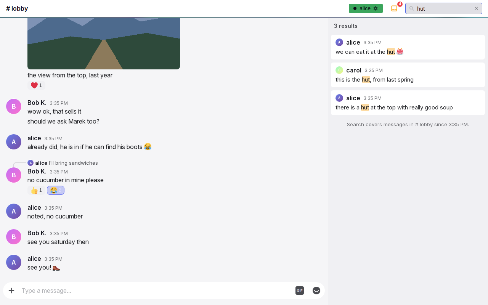
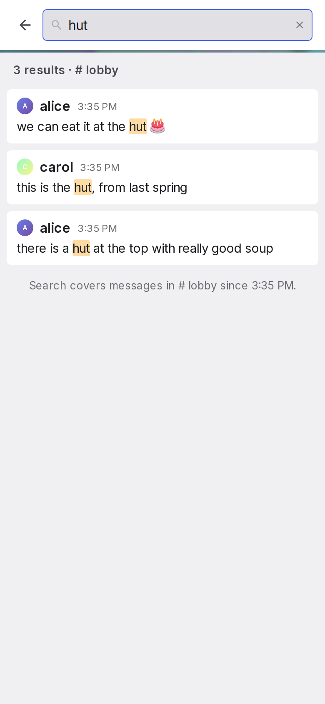
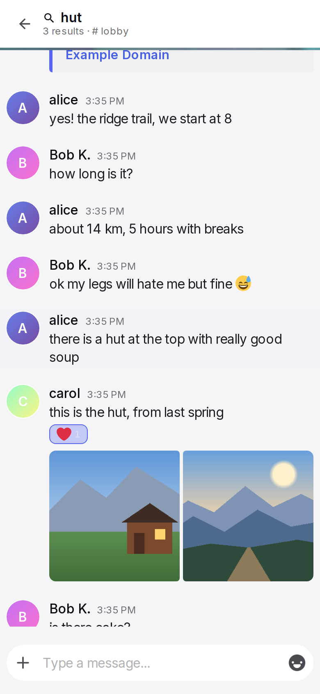

# Search

The search finds messages in the open conversation by their text. The user types a few words and gets the messages that hold all of them, the newest first. A tap on a result shows the message in the conversation. On a wide window the results stand beside the conversation. On a narrow window the search is a screen of its own, and Back returns from a message to the results.

## Anatomy

1. **Search field.** Above 768 px, a field at the right end of the header. It shows a magnifier, a placeholder from the configured list, and an X while it holds text.
2. **Results panel.** Above 768 px, a panel in the place of the sidebar, 420 px wide and at most 45 % of the window.
3. **Count line.** The number of results. At 768 px or less it also names the conversation.
4. **Result.** One message: the avatar, the name, the time, up to 6 lines of the text with the matched words highlighted, and the media as small pictures.
5. **Reach line.** The last line of the list. It names the conversation and says how far back the search reaches.
6. **Search row.** At 768 px or less, the first row of the sidebar. It opens the search screen.
7. **Search screen.** At 768 px or less, a screen over the whole frame: a back arrow and the field at the top, then the count line and the results.
8. **Search header.** At 768 px or less, the header of the conversation while a message from a result shows: a back arrow, the query, and the count line.

## Rules

### What the search finds

**SR-01** The search covers the open conversation only, a room or a direct message. It reads the text of messages. It does not read system lines, link cards or the names of files. A message without text is never a result.

**SR-02** The search covers the messages that the server holds ready: the ones it loaded at its last start, and each message since then. An older message cannot be found. *Why:* no other part of Yap can open such a message either, so the search reaches as far as a scroll does.

**SR-03** The query is a list of words, divided at spaces. A message is a result when its text holds each word. The words can be in any order and at any place, also inside a longer word.

**SR-04** Capital letters and accent marks do not count, in the query and in the text. "prilis" finds "Příliš". A letter that is a letter of its own, such as ł, ø, đ or ß, is found only as it is. A text with characters that cannot be compared in this way is searched as it is, without the accent rule.

**SR-05** A search needs 2 characters. A query has at most 100 characters.

**SR-06** A person finds only messages that the person can read. The history limit of a room applies ([TL-05](timeline.md#TL-05)). A conversation that the person cannot open answers with "Conversation not found.".

### The results

**SR-07** The search runs while the user types, 250 ms after the last key. No key starts it.

**SR-08** The results are message rows, the newest first. A row shows the avatar, the name, the time, the text and the media of the message: pictures, videos and GIFs. It shows no link card, no reply quote and no reactions. A video plays in the row, and it stops when the results give way to a message.

**SR-09** A row shows at most 6 lines of the text. When the first matched word is below the sixth line, the row shows the lines around that word, with the word on the second line. An edge where text is cut fades out.

**SR-10** Each matched word is highlighted in the rows of the results. A match that is inside an emoji, or that runs over the edge of a link, shows no highlight. The conversation shows no highlight of words.

**SR-11** The count line shows the number of all results: "{n} results" or "1 result". The list loads 25 results, and 25 more when the user scrolls near its end. The count does not change while more results load.

**SR-12** After the last result, the reach line shows: "Search covers messages in {name} since {date}." The name is "# {room}" or the name of the partner. The date is the time of the oldest message that the person can read. When the person can read no message, no reach line shows.

**SR-13** When nothing is found, the list shows one text from the configured list for an empty result, and the reach line under it. *Why:* a playful text alone can read as a fact, and the message can be in a different conversation or before the reach.

**SR-14** While the answer loads, the count line shows "Searching…". The results of the query before stay on the screen until the answer comes.

**SR-15** While the query has less than 2 characters, the list shows "Type 2 or more characters" and no results.

**SR-16** A list of results does not change by itself. A new message, an edit or a deletion shows at the next search. A tap on a result whose message is gone shows "Message not found." at the row.

**SR-17** A tap on a result goes to the message, as a tap on a pinned message does ([TL-41](timeline.md#TL-41)). A picture in a result is part of the row, so a tap on it also goes to the message. A refusal shows its reason at the row.

**SR-18** Without a connection, the list shows "Needs a connection" in the place of the results. When the connection returns, the search of the query in the field runs again by itself. A refusal from the server shows its reason in the same place.

### Above 768 px

**SR-19** The search field is at the right end of the header, 200 px wide. It shows only while a conversation is open. Its placeholder is one text from the configured list.

**SR-20** The results panel takes the place of the sidebar when the query has 2 characters. It stays open until the search ends, also when the query gets shorter. The panel shows and goes without animation.

**SR-21** Ctrl+F puts the cursor in the search field while a conversation is open and no layer is open. On an Apple device the key is Cmd+F, and Ctrl+F keeps its own meaning there. When the cursor is already in the field, the key opens the find of the browser. At 768 px or less the key opens the search screen. *Why:* the find of the browser reads only the messages that are loaded, so it misses words that are in the conversation.

**SR-22** The X in the field and Escape end the search. The field is empty again, the panel goes, and the sidebar shows at the place where the user left it. The X shows while the field holds text, and as long as the panel is open. A click on the mailbox also ends the search, because the unread marks are in the sidebar. The search also ends when the user leaves the conversation.

**SR-23** One press of Escape closes one thing. When a layer, a picker or the editor of a message is open, Escape closes that, and the search stays ([GEN-17](general-rules.md#GEN-17)).

### At 768 px or less

**SR-24** The way into the search is the search row at the top of the sidebar. The header has no search control. A tap on the row closes the sidebar and opens the search screen, with the cursor in the field.

**SR-25** The search screen covers the frame. Its header has a back arrow and the field. The count line names the conversation: "{n} results · {name}". The results fill the rest of the screen, and the input box is not on it. The Search key of the keyboard closes the keyboard. Nothing under the screen takes the focus.

**SR-26** A tap on a result shows the conversation at the message, under the search header. The search header has a back arrow, the query with a magnifier, and the count line. The status chip, the pin button, the mailbox and the hamburger do not show. A direct message gets the same header in the place of its own. The search keeps the query, the results and the place in the list. When the answer to a newer query comes while the message shows, the search header shows that query and its count.

**SR-27** Back goes one step back: from a message to the results, at the same place in the list, and from the results to the conversation, which ends the search. The back arrow of the header, the Back of the browser, the Back button and the Back swipe of a phone all do the same. The conversation is not loaded again by a step back.

**SR-28** At a message from a result, a return to the newest messages ends the search, and the regular header comes back. A return is "Go to newest", the down arrow, the new-messages pill, a send of an own message, or a reconnect. A scroll by hand never ends the search. *Why:* a search header over the newest messages reads as a different place. While the results show, a reconnect changes nothing.

**SR-29** The X in the field of the search screen empties the field, and the screen stays for a new query.

**SR-30** The search screen slides in from the right in 0.2 s, and it slides out the same way when the search ends from the results. Between the results and a message, the screen fades in 0.15 s. With reduced motion, nothing moves.

**SR-31** The search ends when the window crosses 768 px in either direction.

### Texts

**SR-32** Two texts come from configured lists, one random text per list: the placeholder of the field, where {0} is the name of the room or of the partner, and the text of an empty result, where {0} is the query. The placeholder is picked once and stays. The other texts of the search are fixed.

## States

| State or trigger | Input | What the user sees |
| --- | --- | --- |
| No search, above 768 px | all | The field in the header with its placeholder. The sidebar. |
| 1 character in the field, above 768 px | keyboard | The sidebar stays. |
| 2 characters, above 768 px | keyboard | The panel in the place of the sidebar. "Searching…", then the count and the results. |
| Query cut to 1 character | keyboard | The panel stays. "Type 2 or more characters". |
| Scroll near the end of the list | mouse, touch | 25 more results. The reach line after the last one. |
| Nothing found | all | The empty text and the reach line. |
| No connection | all | "Needs a connection" in the place of the results. The results show when the connection returns. |
| Click on a result, above 768 px | mouse, keyboard | The message centred and highlighted in the conversation. The panel stays. |
| X or Escape, above 768 px | mouse, keyboard | The field empty, the sidebar back. |
| Field emptied by hand, above 768 px | keyboard | The panel stays with the hint. The X stays and ends the search. |
| Click on the mailbox during a search, above 768 px | mouse | The search is over. The sidebar shows the unread marks. |
| Escape with a picker open | keyboard | The picker closes. The search stays. |
| Ctrl+F, or Cmd+F on an Apple device | keyboard | The cursor in the field. A second press opens the find of the browser. |
| Tap on the search row | touch, mouse | The sidebar closes. The search screen slides in, with the hint and the cursor in the field. |
| Tap on a result, 768 px or less | touch, mouse | The screen fades. The conversation at the message, under the search header. |
| Back at a message from a result | touch, mouse, keyboard | The results, at the same place in the list. |
| Back at the results | touch, mouse, keyboard | The screen slides out. The conversation with its regular header. |
| "Go to newest" at a message from a result | touch, mouse | The newest messages with the regular header. The search is over. |
| Scroll by hand at a message from a result | touch, mouse | The search header stays. |
| X in the field of the search screen | touch, mouse | The field empty, the hint, the screen stays. |
| The window crosses 768 px | all | The search is over. |
| The user leaves the conversation | all | The search is over. |

## Wording

| Where | Text |
| --- | --- |
| Placeholder of the field (configured list; these are the defaults) | "search...", "find the receipts...", "dig up the lore...", "who said what...", "search {0}..."; fallback "Search" |
| Empty result (configured list; these are the defaults) | "crickets...", "nothing. nada. zilch.", "no receipts found", "nobody said {0}", "that never happened"; fallback "No results" |
| Count line | "{n} results"; "1 result"; at 768 px or less "{n} results · {name}" |
| Count line while the answer loads | "Searching…" |
| Hint | "Type 2 or more characters" |
| Reach line | "Search covers messages in {name} since {date}." |
| Search row of the sidebar; accessible name of the fields | "Search this conversation" |
| Tooltips | "Clear search"; "Close search"; "Back to results" |
| Refusals | "Needs a connection"; "Conversation not found."; "Message not found."; "Too old to load" |

## Related

- [Header, sidebar and overlays](frame.md) for the header, the sidebar and the hamburger.
- [Timeline and media](timeline.md) for the jump to a message, the end row and "Go to newest".
- [General rules](general-rules.md) for loading states, Escape and "Needs a connection".
- [Offline and installation](offline.md) for what works without a connection.
