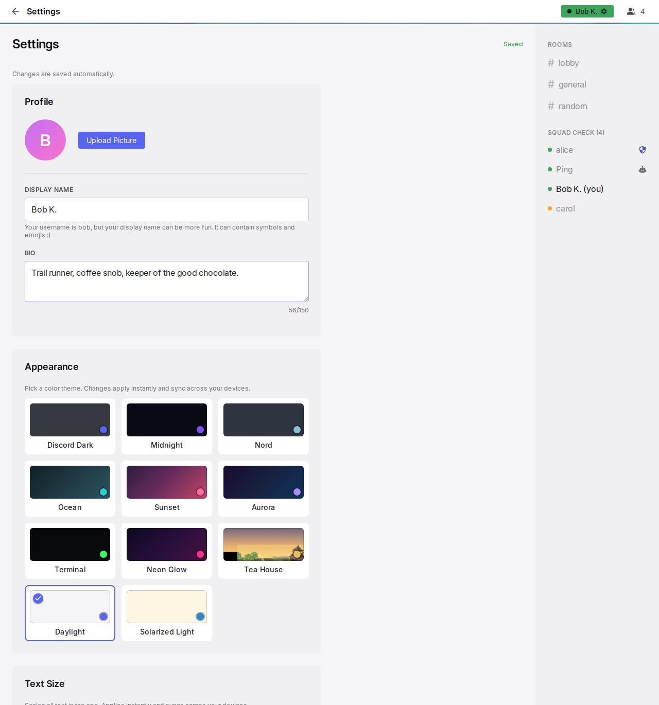

# Settings

Settings is the one page where the user changes their profile, appearance, sign-in methods, devices, notifications, time format and GIF library. It opens from the status menu and from a few links in the app. Every change saves automatically. The page has no Save button.

## Anatomy

1. **Frame.** The same header and sidebar as a conversation. The title area shows a back arrow and "Settings".
2. **Page heading.** "Settings", with a chip on the right and the line "Changes are saved automatically." For profile changes, the chip reads "Saving..." and then "Saved".
3. **Cards.** One column of cards, at most 600 px wide, in this order: Profile, Appearance, Text Size, Login Link, Secret Code (only for an account that still has a code), Active Sessions, Install as App, Notifications on This Device (the heading names the device: iPhone, iPad, Phone or Computer), Allow / Mute Notifications, Time & Date, My GIFs, App version, and a collapsed DEBUG INFO card at the end.
4. **Notice.** An amber notice above the heading, with a close control. It shows after "Sign out all other devices".

## Rules

### Page

**ST-01** Settings opens from "Settings" and "Notification settings" in the status menu. It also opens from "Manage your GIFs in Settings" in the GIF picker. The bot's messages refer to Settings by name. "Notification settings" and the picker link scroll to their sections. The section stays in view while the page fills, until the first tap, scroll or key press. A signed-out visit goes to the login page. Settings needs a connection.

**ST-02** Every control saves at once when its value changes. Profile text saves after a short pause in typing. It also saves when the user leaves the page, so no typed text is lost. A failed save shows "Could not save. Try again." next to the control.

**ST-03** On Settings, the sidebar and the header show live state, the same as on a conversation.

### Profile

**ST-04** The avatar shows at 80 px with "Upload Picture" or "Change Picture". When a picture exists, "Remove" also shows. A picture can be any image up to 10 MB. The server crops the picture to a square. A rejected file shows "Choose an image up to 10 MB". Remove needs no confirmation.

**ST-05** Display Name holds up to 64 characters. Its placeholder is the username. Its hint says that the name can contain symbols and emoji. When Display Name is empty, the username is shown.

**ST-06** Bio holds up to 150 characters and has a live counter. Location holds up to 100 characters. Location has "Detect" when the server can find the country from the network address.

**ST-07** A profile change shows at once in the user's own header and on the user's messages. It also shows at once on the screens of other people.

### Appearance and text size

**ST-08** Appearance shows a grid of theme cards. Each card has a preview, an accent dot and the name. The chosen card has a check badge. The themes are Discord Dark (the default), Midnight, Nord, Ocean, Sunset, Aurora, Terminal, Neon Glow, Tea House, Daylight and Solarized Light. A tap applies the theme to the whole app at once and saves it. When the saved theme no longer exists, the default theme applies.

**ST-09** Tea House changes its picture with the sun. Seven day pictures share the time from sunrise to sunset in equal parts, and five night pictures share the time from sunset to sunrise. Sunrise and sunset are those of the day and of the place: the city of the device's time zone (Copenhagen for Denmark, Nairobi for Kenya), with no location prompt. A time zone without a city (UTC) gets a fixed day from 06:00 to 20:00. From 3:00 to 3:59 a special picture shows, whatever the sun does.

**ST-10** Text Size has six presets: 14, 15, 16 (Default), 17, 18 and 20 px. Each preset shows as "Aa" at its size. A tap changes the size of all text at once and saves it. The account's other devices apply the theme and the text size at once.

### Sign-in methods

**ST-11** Login Link starts with one line that summarises the sign-in methods of the account. The line is either "This account is tied to this device only." or the methods that the person has. The methods show in this order: login link, secret code, smart login.

**ST-12** With a link, the card shows the hint, the URL with its code masked, and Reveal and Copy. Then it shows "New Link", "Revoke" and the expiry choice. Without a link, the card shows the hint and "Create Login Link". The rules are on the [sign-in page](sessions.md#AU-11).

**ST-13** "Allow smart login" is a switch under the link. It shows only while the admin allows smart login. It is on by default.

**ST-14** Secret Code is below Login Link, and only for an account that still has a code. *Why:* the code is retired, and the login link does its job ([AU-13](sessions.md#AU-13)). The card shows the masked code, Reveal and Copy, "New Code" and "Disable". Disable asks for a confirmation, because a disabled code cannot come back. After it, the card is gone and the status shows under Login Link. Status lines show for 3 seconds.

### Devices

**ST-15** Active Sessions lists the account's connected devices. Each device has a phone or desktop icon, the network address and "Active {time}". The current device shows "This device" and is always listed. "Sign out all other devices" is always available, because a device can stay signed in without a connection. It is disabled during the first hour of the current device, with the text that says when it is available. It acts without a confirmation. After it, the page shows the notice "All other devices have been signed out." with the new secret code, when one exists.

**ST-16** Install as App shows "Install {name}" with its explanation. The explanation tells the person to open the app after the install and turn on notifications there. Inside the installed app, it shows "{name} is installed as an app on this {device}." instead. {name} is the server's name, which is also the name under the installed app's icon. See [Offline and installation](offline.md).

### Notifications

**ST-17** The notifications card is named for the device: "Notifications on This iPhone", "This iPad", "This Phone" or "This Computer". Its text says what the person will see on this device when the app is closed, and nothing about push: a notification and a number on the app's icon for the installed app on a phone, a pop-up in the corner of the screen and a count in the tab title for a browser on a computer. A phone user reads that the phone treats the app like any other app, with its own entry under the phone's Settings. A browser on an iPhone or iPad cannot show notifications; the card says so and points to Install as App. The card shows the state of this device ("On", "Off", "Blocked", "Not possible here" or "Not set up on this server"), with a green check mark next to "On" and a red crossed bell next to every other state, the number of phones and computers that get notifications, and their list. Each entry has "Remove", and Remove on the entry marked "This device" turns notifications off here; there is no second button for that. The card shows "Turn on notifications on this {device}" only while this device is not in the list. When that is not possible, the card gives the reason. For a block, it gives the exact steps for this browser, or for the phone's Settings in the installed app. The card redraws when the person comes back to it, so a fix made in the phone's Settings shows at once. "Send a test to all my devices" shows when there are devices. The server's name stands in for "Yap" throughout. *Why:* the people who asked "why is my phone quiet" had installed the app and never found the switch behind "push" and "subscribe".

**ST-18** Allow / Mute Notifications starts with the server-wide "Allow" or "Mute" with a duration. Below it are the "Direct messages" and "Rooms" rows, each with "Allow", "Individual" and "Mute". In Individual mode, a row lists its conversations, each with a bell. The rules are on the [notifications page](notifications.md#NT-16). The mute hint reads "Muted for another {time}." with the correct singular form. The hint counts down while the page is open.

**ST-27** A red notice sits at the top of Allow / Mute Notifications when this device gets no notifications: they are off or blocked on this device, or this browser cannot show them. It says so in one sentence and links to the card above that has the switch or the fix. It goes away as soon as notifications are on here. *Why:* the rules below belong to the account. A person with a quiet phone would otherwise change the mutes and see no effect.

### Time & Date

**ST-19** "Your time" shows the current time in the user's time zone, with "−", "+" and "Detect". Yap detects the zone at sign-up. The zone stays until the user changes it here. "−" and "+" move the shown time by one hour from its current value. The offset from universal time stays within 14 hours in either direction. After an adjustment, the zone is a fixed offset and daylight saving no longer applies. "Detect" takes the zone from the browser again. The language detected at sign-up sets the defaults below. The language has no control of its own.

**ST-20** Clock offers 24-hour and 12-hour. Date order offers day-month-year, month-day-year and year-month-day. Separators shows when the detected language and the country of the zone use different formats. Each of the three is a row of cards. Each card shows the current time or today's date in its form. The card that matches the language is first. Each row works with the keyboard. The choices apply to every time in the app.

### My GIFs

**ST-21** My GIFs shows the user's pool: every starred GIF plus the user's own uploads, in folders. The toolbar has folder chips ("All", "Unsorted", one per folder), a filter field, "＋ Add GIFs", "Import zip" and "Export". The filter field shows when there are nine or more GIFs. A quota bar shows "{used} of {quota} used" for the user's own uploads. Starred GIFs do not count against the quota.

**ST-22** Add accepts several .gif, .webp or short video files at once, up to 50 MB each. The files go into the open folder. A progress line shows, and one error line shows for each refused file. Import accepts one zip up to the configured size (1 GB by default). The zip can have at most 1000 files of 50 MB each. Its subfolders become folders. When it has a tag list, the tag list adds tags. Export downloads the pool as a zip that imports back without loss, except starred provider GIFs that the server never stored.

**ST-23** Cards show newest first. They refresh at once when a star or an upload elsewhere changes the pool. A card shows the preview, up to four tag chips and the folder choice. The user edits tags in place. Tags are converted to lowercase. Each tag has 2 to 64 characters. Tags belong to the GIF, so a change affects search for everyone who can see the GIF. The user creates a new folder from the folder choice, with a name of up to 64 characters. A folder disappears when it no longer holds a GIF.

**ST-24** "Delete" on one of the user's own uploads asks "Sure?" before it deletes the file. When the file is still used in chat or by others, it is removed from the pool instead. It still counts against the quota while it exists. "✕" removes the star at once. Six cards show first, then 24 more for each tap.

### App version

**ST-28** The App version card shows the build this device runs and, when the server runs a newer one, the server's build and a note. "Reload the app" fetches the page from the server, so the device gets the server's build even when its service worker stays on an old one, and the person lands back on Settings.

### Debug

**ST-25** DEBUG INFO is a collapsed card. It shows what the browser keeps for Yap on this device: cached files by group with their size, and the storage estimate. It also has "Clear this cache" for the media cache. Clearing keeps drafts and unsent messages. Below the caches it lists the emoji images of this page load with the time each was asked for and answered, whether the service worker was in the path and whether a cache answered (the diagnostic for the cold-open wait).

### Phones

**ST-26** At 600 px or less, the avatar is above its buttons. The notification rows stack, with full-width controls and 44 px buttons. The three choices of a row share one line on a 375 px phone at every text size. A 320 px phone at the largest text size wraps them. In a device list, the Remove button is under the device's text, at the right. The link controls wrap. The GIF grid has two columns.

## States

| State or trigger | Input | What the user sees |
| --- | --- | --- |
| Typing in a profile field | keyboard | "Saving..." then "Saved" for 2 s. |
| Leaving the page right after typing | all | The edit is saved. |
| Picture chosen | mouse, touch | The avatar updates and "Saved" shows. A bad file shows "Choose an image up to 10 MB". |
| Theme tap | mouse, touch | The whole app changes to the new theme at once. |
| Text size tap | mouse, touch | All text changes size at once. |
| New Link, Revoke, expiry | mouse, touch | The link shows or is removed. A green status shows for 3 s. |
| New Code | mouse, touch | The new code shows. A green status shows for 3 s. |
| Disable | mouse, touch | A confirmation, then the Secret Code card disappears. A green status shows under Login Link for 3 s. |
| Sign out all other devices | mouse, touch | The other devices are signed out. The amber notice shows, and the code is revealed. |
| Turn on notifications | mouse, touch | The browser or the phone asks for permission. "On" shows, a device row appears, and the red notice above Allow / Mute goes away. |
| Send a test | mouse, touch | Every device gets the test notification. A result line shows for 3 s. |
| Mute picked | mouse, touch | The direct message and room rows are hidden. The card shows "Muted until you turn notifications back on." |
| Mute with a duration | mouse, touch | "Muted for another {time}." |
| Individual mode | mouse, touch | A bell for each conversation shows under the row. |
| − or + on the time | mouse, touch, keyboard | The shown time moves by one hour, and the change is saved. |
| Date order or clock card | mouse, touch, keyboard | Times change everywhere in the app. |
| Add GIFs | mouse, touch | A progress line shows. Cards appear. Errors show in a red strip. |
| Tag chip tap | mouse, touch | An inline tag input opens. Enter saves and Escape cancels. |
| Delete own upload | mouse, touch | "Sure?", then the card disappears, or the GIF is removed from the pool with a note. |

## Wording

| Where | Text |
| --- | --- |
| Page | "Settings"; "Changes are saved automatically."; "Saving..."; "Saved" |
| Notice | "All other devices have been signed out."; "Your login link keeps working."; "Your secret code was automatically changed. See the new one below." |
| Page | "Could not save. Try again." |
| Profile | "Profile"; "Upload Picture"; "Change Picture"; "Uploading..."; "Remove"; "Choose an image up to 10 MB"; "Display Name"; "Your username is {username}, but your display name can be more fun. It can contain symbols and emojis :) "; "Bio"; "Why are you awesome..."; "{n}/150"; "Tell us where are you from - map is in the making!"; "Your location — used for the user map"; "London"; "Detect" |
| Appearance | "Appearance"; "Pick a color theme. Changes apply instantly and sync across your devices."; "Discord Dark"; "Midnight"; "Nord"; "Ocean"; "Sunset"; "Aurora"; "Terminal"; "Neon Glow"; "Tea House"; "Daylight"; "Solarized Light" |
| Text Size | "Text Size"; "Scales all text in the app. Applies instantly and syncs across your devices."; "Aa"; "14px"; "15px"; "Default"; "17px"; "18px"; "20px" |
| Login Link, Secret Code, Active Sessions | see the [sign-in page](sessions.md#wording) |
| Install | "Install as App"; "Install {name} on your home screen for full screen and quick access. Then open the app and turn on notifications." (on a computer "as an app on this computer" replaces "on your home screen"); "Install {name}"; "{name} is installed as an app on this {device}." |
| Push and mutes | see the [notifications page](notifications.md#wording); mute time "1 minute", "{n} minutes", "1 hour", "{n} hours", "1 day", "{n} days", "a moment" |
| Time & Date | "Time & Date"; "Your time"; "−"; "+"; "−1 hour"; "+1 hour"; "Detect"; "Adjust if the time doesn't match your clock"; "Clock"; "Date order"; "Separators"; "Detected: {time zone} · {locale}" |
| My GIFs | "My GIFs"; "Your GIF pool — everything you've starred plus your own uploads. Organize with folders, edit search keywords, or bring a whole collection: import files or a zip, and export everything as a zip you can take anywhere."; "All"; "Unsorted"; "Filter by keyword…"; "＋ Add GIFs"; "Uploading…"; "Import zip"; "Export"; "{used} of {quota} used"; "Only your own uploads count — starred GIFs are free"; "Uploading… {p}% ({done} of {total})"; "Importing… {done} of {total}"; "Imported {done} of {total}"; "processing…"; "add keywords…"; "+{n}"; "comma, separated, tags"; "(unsorted)"; "＋ New folder…"; "folder name"; "Delete"; "Sure?"; "Still used in chat or by others — removed from your library instead."; "You can only delete your own uploads."; "Nothing here yet — star GIFs in the picker, or add your collection above."; "No GIFs match your filter."; "Nothing in this folder."; "Show 24 more ({n} left)"; "Show {n} more"; "Show less"; "ffmpeg not detected — video conversion is off, only .gif/.webp files can be imported." |
| My GIFs errors | "\"{name}\" — unsupported file type"; "\"{name}\" — too large ({n} MB, max {m} MB)"; "\"{name}\" — {error}" with "upload failed" when there is none; "GIF storage quota exceeded"; "Not allowed"; "Could not process this file as a GIF"; "Upload failed — something went wrong."; "GIF storage quota exceeded — import stopped"; "import failed — the zip could not be read"; " ({n} skipped)"; " — {n} skipped" |
| App version | "App version"; "On this device"; "On the server"; "This is the latest version."; "A newer version is on the server. Reload to get it."; "Reload the app" |
| Debug | "DEBUG INFO"; "Reading cache…"; "Cache report unavailable."; "Cached files"; "1 file" or "{n} files" with "· {size}"; "Origin storage estimate"; "{used} of {quota}"; groups "Media — saved chat attachments", "App — offline interface", "Emoji — downloaded artwork"; "Empty"; "Clear this cache"; "Clearing a cache keeps your locally saved drafts and outgoing messages." |

## Related

- [Sign-in and sessions](sessions.md) for the link, the code and the devices.
- [Notifications and unread](notifications.md) for the two notification sections.
- [Emoji and GIF pickers](pickers.md) for where the GIF pool is used.
- [Message row and actions](message-row.md) for how times are shown.
- [Offline and installation](offline.md) for the install section.
- [Header, sidebar and overlays](frame.md) for the frame around the page.
